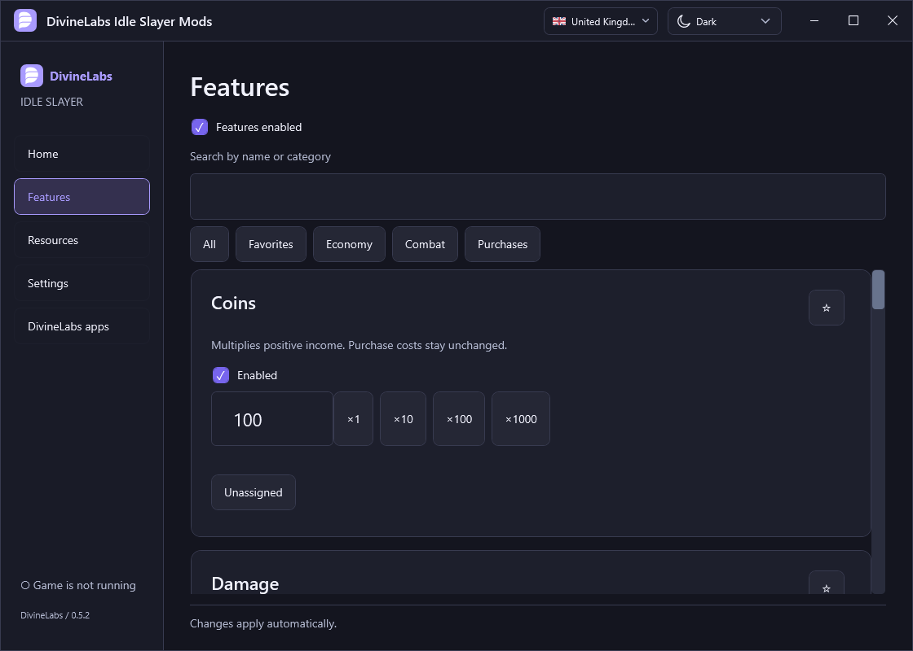

[English](../../README.md) · [Русский](README.ru.md) · [Українська](README.uk.md) · [Беларуская](README.be.md) · [Deutsch](README.de.md) · **Español** · [한국어](README.ko.md) · [简体中文](README.zh.md) · [日本語](README.ja.md)

# DivineLabs Idle Slayer Mods

Lanzador de mods para Idle Slayer en Windows. Gestiona las modificaciones, los ajustes y el menú del juego.

## Descargar

**[Instalador](https://github.com/TheDivineLabs/DivineLabs_IdleSlayer_Mods/releases/latest/download/DivineLabs.Idle.Slayer.Mods.exe)** · **[ZIP portable](https://github.com/TheDivineLabs/DivineLabs_IdleSlayer_Mods/releases/latest/download/DivineLabs-IdleSlayer-0.5.3-portable.zip)**

Windows x64 · Steam · Idle Slayer 7.3.4 (compilación 25810322). No hace falta instalar .NET por separado.

Lanzador, instalador y desinstalador: nueve idiomas. Menú del juego: ruso.

## Funciones

- Multiplicadores de monedas, daño y almas.
- Añadir recursos: monedas, SP, DP, USP y materiales.
- Compras gratuitas con recursos del juego.
- Menú del juego, widget que puedes arrastrar y lista de funciones activas.

## Primeros pasos

1. Instala Idle Slayer desde Steam.
2. Ejecuta el instalador o extrae el ZIP portable y abre `DivineLabs.IdleSlayer.exe`.
3. Abre el lanzador y pulsa **Jugar**. Usa **Insert** para abrir el menú dentro del juego.

## Soporte

[Discord](https://discord.gg/vF47ExMQpn) · [Telegram](https://t.me/ps1xo_on1ks) · [Informar de un error](https://github.com/TheDivineLabs/DivineLabs_IdleSlayer_Mods/issues/new/choose)

## Licencia

Código de DivineLabs: [MIT](../../LICENSE). Las dependencias conservan sus propias [licencias](../../THIRD-PARTY-NOTICES.txt).

Proyecto no oficial. Idle Slayer es obra de Pablo Leban; el juego no está incluido.

[Desarrollo](../../docs/DEVELOPMENT.md)
